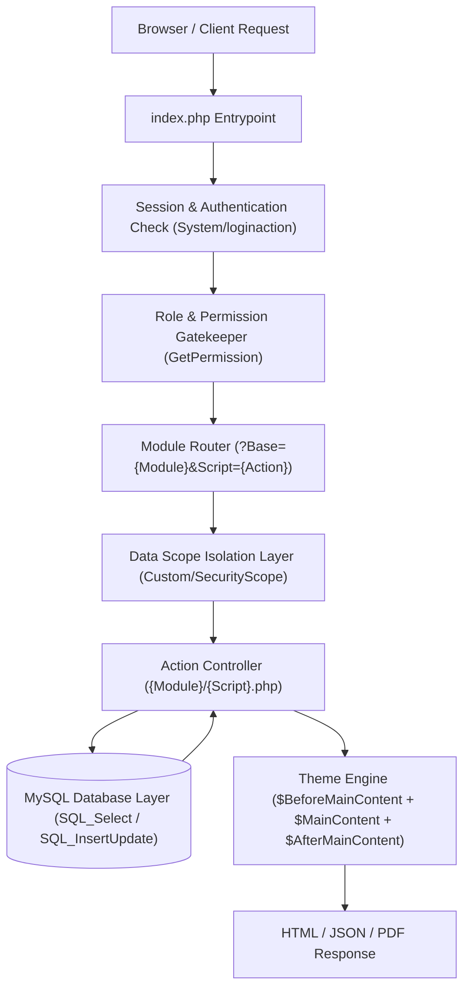

# LifeLine Hospital ERP — Architecture & System Design

This document details the software architecture, design patterns, request routing, data layer abstraction, and execution pipeline of the LifeLine Hospital ERP system.

---

## 🏗 Architectural Paradigm

The ERP uses an enhanced **Modular Fusebox Architecture** (Action-Domain-Responder / Model-View-Controller variant) tailored for enterprise procedural and lightweight OOP execution in PHP 5.6+:



---

## 🔄 Request Routing Lifecycle

Every web interaction in the ERP is routed through a single master entrypoint with standardized URL query parameters:

```
index.php?Theme={theme_name}&Base={module_name}&Script={script_name}&{parameters}
```

### Routing Parameters
1. **`Theme`**:
   - Selects the active UI presentation layer (e.g. `Theme=default`).
   - The theme template wrapper lives in `theme/{Theme}/template/header.php` and `footer.php`.
2. **`Base`**:
   - Identifies the module directory to execute (e.g. `Base=Sales`, `Base=Customer`, `Base=Commission`, `Base=CrVoucher`).
3. **`Script`**:
   - Identifies the target script inside the module folder without the `.php` extension.
   - Standard CRUD script conventions:
     - `Manage`: Datagrid list view with searching, sorting, pagination, and action links.
     - `Insertupdate`: Insert/Edit form generator.
     - `Insertupdateaction`: Form validation, file upload handling, and DB persistence.
     - `Print` / `MoneyReceipt`: Printable voucher/statement view (often invoked with `&NoHeader&NoFooter`).

---

## 🗄 Modular Folder Anatomy

Every module follows a strictly uniform structure:

```
{Module}/
├── Scriptvariables.php       # Entity names, table names, primary key, caption definitions
├── Manage.php                # List records (CTL_Datagrid, SearchBox, Filters)
├── Insertupdate.php          # Add/Edit form controls ($Input array, FormInsertUpdate)
├── Insertupdateaction.php    # Form POST handler, validation, SQL_InsertUpdate
├── Script/                   # (Optional) Helper scripts, modals, or AJAX endpoints
└── (Special Actions).php     # E.g. MoneyReceipt.php, Print.php, AjaxRequest.php
```

### Scriptvariables.php Specification
`Scriptvariables.php` initializes standardized variables for the module:
```php
<?php
    $Entity = "Customer";               // Target DB Table entity (without 'tbl' prefix)
    $EntityLower = "customer";          // Lowercase entity name
    $EntityCaption = "Customer";        // Human-readable title
    $EntityCaptionLower = "customer";   // Lowercase title
    $UniqueField = "Phone";             // Column used for uniqueness validation
    $OrderByValue = "CustomerID";       // Default ORDER BY primary key
?>
```

---

## 🛡 Security & Scope Isolation Layer (`Custom/SecurityScope.php`)

All sensitive read queries pass through `SecurityScope.php`, guaranteeing data isolation before executing against MySQL:

### 1. Customer Isolation (`SecurityScope::getCustomerWhereCondition()`)
- **SuperAdmin / Global Scope (`OptionCustomerScope = 1`)**:
  - Expression: `1 = 1` (All customers)
- **Salesperson (`user_type = 'salesperson'`, `OptionCustomerScope = 0`)**:
  - Expression:
    ```sql
    (CustomerID IN (
        SELECT CustomerID FROM tblsales 
        WHERE SalespersonUserID = {uid} 
           OR SellerID = {uid} 
           OR SalerNameID = 'user_{uid}'
    ) OR CreatedByUserID = {uid})
    ```
- **Director (`user_type = 'director'`, `OptionCustomerScope = 0`)**:
  - Automatically identifies all salespersons referred by this Director:
    ```sql
    (CustomerID IN (
        SELECT CustomerID FROM tblsales 
        WHERE DirectorUserID IN ({director_and_team_ids}) 
           OR SalespersonUserID IN ({director_and_team_ids}) 
           OR SellerID IN ({director_and_team_ids})
           OR SalerNameID IN ({saler_names})
    ) OR CreatedByUserID IN ({director_and_team_ids}))
    ```

### 2. Sales Isolation (`SecurityScope::getSalesWhereCondition()`)
- **Salesperson**:
  ```sql
  (SalespersonUserID = {uid} OR SellerID = {uid} OR SalerNameID = 'user_{uid}')
  ```
- **Director**:
  ```sql
  (DirectorUserID IN ({ids}) OR SalespersonUserID IN ({ids}) OR SellerID IN ({ids}) OR SalerNameID IN ({saler_names}))
  ```

### 3. Commission Isolation (`SecurityScope::getCommissionWhereCondition()`)
- **Salesperson / Director (Personal)**:
  ```sql
  UserID = {loggedInUserID}
  ```
- **URL Tampering Protection**:
  ```php
  if (!SecurityScope::enforcePersonalCommissionOnly($requestedUserID)) {
      $requestedUserID = $_SESSION['UserID']; // Force override
  }
  ```

---

## 🗃 Database Abstraction Layer (DAL)

The system utilizes lightweight, high-performance database functions:

| Function | Signature | Purpose |
| :--- | :--- | :--- |
| `SQL_Select` | `SQL_Select($table, $where, $order, $singleRow, $from, $limit, $debug)` | Executes SELECT query; returns associative array of records or single row. |
| `SQL_InsertUpdate`| `SQL_InsertUpdate($entity, $dataArray, $whereCondition)` | If `$whereCondition` is empty, executes `INSERT`; if provided, executes `UPDATE`. |
| `SQL_Delete` | `SQL_Delete($entity, $whereCondition)` | Executes safe `DELETE FROM tbl{entity} WHERE {condition}`. |
| `CTL_Datagrid` | `CTL_Datagrid($entity, $columns, $titles, $aligns, $types, $rows, ...)` | Renders pagination, sorting headers, search bar, and action links table. |
| `FormInsertUpdate`| `FormInsertUpdate($entity, $title, $inputArray, $button, $actionURL)` | Generates responsive Bootstrap form layout from structured input definitions. |

---

## 🎨 Theme & Rendering Architecture

Themes are decoupled from business logic:
- `$BeforeMainContent`: Contains HTML `<head>`, CSS stylesheets, top navigation bar, and responsive sidebar menu.
- `$MainContent`: The active controller appends all HTML output to `$MainContent`.
- `$AfterMainContent`: Footer scripts, modals, toast notification listeners, and closing tags.

When generating printable documents (such as Money Receipts, Vouchers, EMI Statements), appending `&NoHeader&NoFooter` bypasses `$BeforeMainContent` and `$AfterMainContent`, returning only pure, CSS print-media optimized layouts.

---

## ⚡ Backward Compatibility (PHP 5.6 Guarantee)
1. **Null Coalescing**: Uses `isset($arr['key']) ? $arr['key'] : $default` instead of `$arr['key'] ?? $default`.
2. **Type Declarations**: Avoids scalar type hints and return type declarations on functions.
3. **Array Initializers**: Standard `array(...)` and `[]` shorthand.
4. **Closures**: Traditional iterations used instead of arrow functions (`fn() =>`).

---
*Maintained by NIBIZ SOFT Technical Team.*
