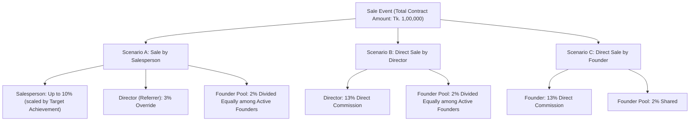

# Commission & Referral Hierarchy System

This document outlines the business rules, mathematical formulas, referral validation, target scaling, and financial ledger architecture of the Commission Engine in LifeLine Hospital ERP.

---

## 📈 Multi-Tier Commission Distribution Structure

The system allocates a standard **15.00%** total commission on property and share sales based on the role and referral hierarchy:

---

## 📐 Mathematical Formulas

### 1. Monthly Sales Target Scaling Formula
Salespersons are assigned a monthly sales count target (e.g., 10 sales per month). If a salesperson sets a target of 0, they have no target constraints and receive the full 10% rate.

For standard targets:
$$\text{Achievement Ratio} = \min\left(1.0, \frac{\text{Actual Completed Sales in Month}}{\text{Monthly Target}}\right)$$

$$\text{Effective Commission Rate} = 10.00\% \times \text{Achievement Ratio}$$

$$\text{Salesperson Commission} = \text{Collection Amount} \times \text{Effective Commission Rate}$$

#### Example:
- Target: 10 sales.
- Actual sales achieved in month: 7 sales.
- Achievement Ratio: $7 / 10 = 0.70$ (70%).
- Effective Rate: $10\% \times 0.70 = 7.00\%$.
- On a Tk. 100,000 collection, Salesperson earns: Tk. 7,000.

---

### 2. Director Referral Override
- Applicable when a sales executive under the Director makes a sale.
- Rate: Fixed **3.00%** of collected payment.
- Unaffected by the salesperson's target penalty.

---

### 3. Director Direct Sale
- When a Director closes a client directly without an intermediate salesperson:
- Rate: Fixed **13.00%** (10% salesperson share + 3% director referral share).

---

### 4. Founder Pool Sharing (2%)
- Fixed **2.00%** pool accrued from every approved collection company-wide.
- Divided equally among all active Founders (`user_type = 'founder' AND UserIsActive = 1`):
$$\text{Per Founder Pool Share} = \frac{\text{Collection Amount} \times 2\%}{N_{\text{active founders}}}$$

---

## 🛡 Strict Referral Tree Validation

The referral hierarchy enforces acyclic tree constraints validated by `CommissionEngine::validateReferralChain()`:
1. **Founders**: Cannot have a referrer (`referred_by = 0`).
2. **Directors**: Must be referred by an active **Founder**.
3. **Salespersons**: Must be referred by an active **Director** or an active **Founder**.
4. **General Users**: Cannot participate in referral trees.
5. **Cycle Detection**: Self-referrals and circular references ($A \to B \to A$) are strictly blocked on save.

---

## 🏛 Immutable Financial Ledger (`tblcommission_transactions`)

All commission accruals, payouts, and reversals are written to `tblcommission_transactions` as immutable double-entry records:

### Schema Fields
- `CommissionTransactionUUID`: Unique identifier for external audit tracking.
- `TransactionReference`: Code format `COMM-{YYYYMMDD}-{SalesID}-{VoucherID}-{Seq}`.
- `UserID`: Target beneficiary user ID.
- `UserType`: `salesperson`, `director`, or `founder`.
- `SalesID`: Related sale record in `tblsales`.
- `VoucherID`: Credit voucher record in `tblcrvoucher`.
- `TransactionType`:
  - `salesperson_commission`: Earned sales commission.
  - `director_referral`: Director override commission.
  - `director_direct`: Director direct sale commission.
  - `founder_pool`: Founder pool dividend.
  - `payout`: Bank/cash disbursement to the agent.
  - `reversal`: Administrative debit or correction.
- `Direction`: `credit` (payable to user) or `debit` (payout deduction).
- `Amount`: Net currency amount in BDT.

---

## 💳 Payout Workflow

1. **Balance Lookup**: `CommissionEngine::getUserBalance($userID)` computes:
   $$\text{Current Payable Balance} = \sum \text{Credits} - \sum \text{Debits}$$
2. **Disbursement Entry (`Commission/Pay.php`)**:
   - Authorized accounts officer records payment mode (Cash, Bank Transfer, Cheque).
   - Generates a debit ledger entry and links to Bank/Cash accounting.
3. **Receipt & Acknowledgement Slip**:
   - Generates a printable voucher slip with signatures for the recipient and approving officer.
4. **Audit Trail & Reversal**:
   - If an error occurred, authorized admins can issue a reversible compensating entry without deleting history.

---
*Maintained by NIBIZ SOFT Technical Team.*
