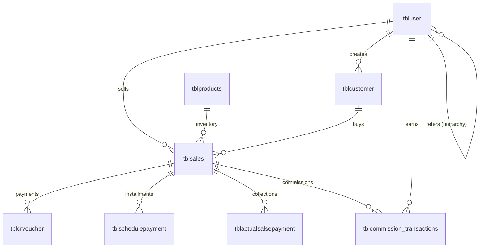

# LifeLine Hospital ERP — Database Schema Reference

This document describes the schema architecture, primary keys, relationships, indices, and data dictionaries of key tables in the LifeLine Hospital ERP system.

---

## 🗄 Entity Relationship Model

---

## 📋 Core Table Specifications

### 1. `tbluser` — Users & Permission Registry
Stores staff accounts, authentication credentials, roles, referral relationships, and module permissions:
- `UserID` (INT 11, Primary Key, Auto Increment)
- `UserName` (VARCHAR 100, Unique Enroll Number, e.g. `LLH-SP-1001`)
- `NameFirst` (VARCHAR 100, Full Name)
- `UserEmail` (VARCHAR 100, Unique Email)
- `UserPassword` (VARCHAR 255, Password)
- `user_type` (VARCHAR 30, `general`, `salesperson`, `director`, `founder`, `admin`)
- `referred_by` (INT 11, Parent UserID in referral hierarchy)
- `FounderSharePercent` (DECIMAL 5,2, Share of 2% pool if percentage distribution is used)
- `MonthlySalesTarget` (INT 11, Monthly sales count goal; default: 10, 0 = no target)
- `OptionCustomer` (TINYINT 2, Module access flag)
- `OptionCustomerScope` (TINYINT 1, `0` = Own/Team Only, `1` = Global/All)
- `OptionSales` (TINYINT 2, Module access flag)
- `OptionSalesScope` (TINYINT 1, `0` = Own/Team Only, `1` = Global/All)
- `OptionCommission` (TINYINT 2, Module access flag)
- `OptionCommissionScope` (TINYINT 1, `0` = Personal Only, `1` = Global/All)
- `UserIsActive` (TINYINT 1, Status: 1 = Active, 0 = Disabled)

---

### 2. `tblcustomer` — Customer & Lead Profiles
Stores patients, real estate buyers, and share subscribers:
- `CustomerID` (INT 11, Primary Key, Auto Increment)
- `CustomerNo` (VARCHAR 50, Auto-formatted file number: `LLH-YYYY/ID`)
- `CustomerName` (VARCHAR 255, Full Name)
- `FathersOrHusbandName` (VARCHAR 255)
- `MotherName` (VARCHAR 255)
- `NomineeName` (VARCHAR 255)
- `NomineePhone` (VARCHAR 50)
- `Phone` (VARCHAR 50, Primary mobile contact)
- `Whatsapp` (VARCHAR 50, WhatsApp number for statement/receipt delivery)
- `CustomerEmail` (VARCHAR 100)
- `NID` (VARCHAR 50, National ID number)
- `Address` (TEXT, Present mailing address)
- `ParmanentAddress` (TEXT, Permanent address)
- `CreatedByUserID` (INT 11, UserID of the staff who added the lead/customer)
- `CustomerIsActive` (TINYINT 1)

---

### 3. `tblsales` — Sales Contracts & Bookings
Stores property, share, and product contracts:
- `SalesID` (INT 11, Primary Key, Auto Increment)
- `CustomerID` (INT 11, Foreign Key to `tblcustomer`)
- `ProductID` (INT 11, Foreign Key to `tblproducts`)
- `ProjectID` (INT 11, Foreign Key to `tblcategory`)
- `SalesDate` (DATE, Contract date)
- `Quantity` (INT 11, Number of shares / units)
- `TotalContractAmount` (DECIMAL 15,2, Final agreed price)
- `SalerNameID` (VARCHAR 50, Seller reference, e.g. `user_43`)
- `SellerID` (INT 11, Direct Seller UserID)
- `SalespersonUserID` (INT 11, Preserved Salesperson UserID)
- `DirectorUserID` (INT 11, Preserved Director UserID)
- `FounderUserID` (INT 11, Preserved Founder UserID)
- `IsDirectorDirectSale` (TINYINT 1, Flag: 1 if Director closed sale directly)
- `CommissionRuleVersion` (VARCHAR 50, E.g. `v1.0`)
- `CommissionEligibilityStatus` (VARCHAR 50, `pending_collection`, `eligible`, `disbursed`)

---

### 4. `tblcommission_transactions` — Financial Commission Ledger
Immutable financial ledger for agent earnings, payouts, and adjustments:
- `CommissionTransactionID` (INT 11, Primary Key, Auto Increment)
- `CommissionTransactionUUID` (VARCHAR 36, UUID for audits)
- `TransactionReference` (VARCHAR 100, E.g. `COMM-20261123-14-43-1`)
- `UserID` (INT 11, Beneficiary agent UserID)
- `UserType` (VARCHAR 30, `salesperson`, `director`, `founder`)
- `SalesID` (INT 11, Originating sale ID)
- `VoucherID` (INT 11, Originating collection voucher ID)
- `TransactionType` (`salesperson_commission`, `director_referral`, `director_direct`, `founder_pool`, `payout`, `reversal`)
- `Direction` (`credit` = income to agent, `debit` = payout deduction)
- `CommissionRate` (DECIMAL 5,2, Applied percentage rate)
- `BaseAmount` (DECIMAL 15,2, Base collection amount in BDT)
- `Amount` (DECIMAL 15,2, Net transaction value in BDT)
- `Description` (TEXT, Human-readable line item explanation)
- `TransactionDate` (DATE)

---

### 5. `tblcommission_rules` — Commission Policy Rules
Stores effective commission percentages and distribution formulas:
- `CommissionRuleID` (INT 11, Primary Key, Auto Increment)
- `RuleVersion` (VARCHAR 50, Unique version code, e.g. `v1.0`)
- `TotalCommissionPercent` (DECIMAL 5,2, Standard: 15.00%)
- `SalespersonMaxCommissionPercent` (DECIMAL 5,2, Standard: 10.00%)
- `FounderBaseCommissionPercent` (DECIMAL 5,2, Standard: 5.00%)
- `DirectorDirectSaleCommissionPercent` (DECIMAL 5,2, Standard: 13.00%)
- `DirectorReferralCommissionPercent` (DECIMAL 5,2, Standard: 3.00%)
- `FounderReferralCommissionPercent` (DECIMAL 5,2, Standard: 2.00%)
- `MonthlySalespersonTargetDefault` (INT 11, Standard: 10)
- `TargetFormula` (VARCHAR 100, Standard: `MIN(Actual/Target, 1)`)

---

### 6. `tblcrvoucher` — Credit Vouchers (Receipts)
- `CrVoucherID` (INT 11, Primary Key, Auto Increment)
- `SalesID` (INT 11, Related sales contract ID)
- `Date` (DATE, Collection date)
- `Amount` (DECIMAL 15,2, Collected amount)
- `BankCashID` (INT 11, Receiving Bank/Cash ledger)
- `PaymentType` (VARCHAR 100, Booking Money, Down Payment, Installment)
- `Description` (TEXT, Remarks/Particulars)

---

## 🔄 Self-Healing Database Provisions
The system automatically checks and creates any missing tables or columns on runtime:
1. `CommissionEngine::ensureTablesExist()` provisions `tblcommission_rules` and `tblcommission_transactions`.
2. `SecurityScope::ensureTables()` checks and creates:
   - `tbluser.OptionCustomerScope`
   - `tbluser.OptionSalesScope`
   - `tbluser.OptionCommissionScope`
   - `tblcustomer.CreatedByUserID`

---
*Maintained by NIBIZ SOFT Technical Team.*
