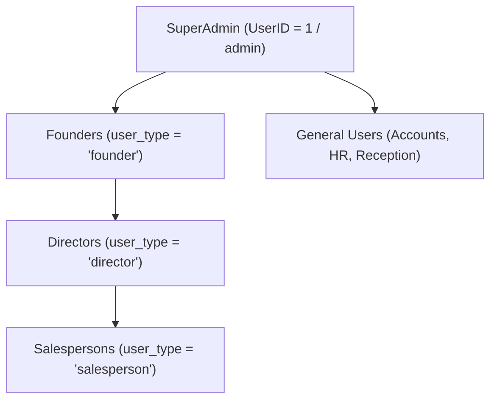

# Permissions, Roles & Security Scopes Guide

This document specifies the user hierarchy, permission matrix, data access scopes, and configuration interfaces across LifeLine Hospital ERP.

---

## 👥 User Roles & Hierarchy



### Role Definitions
1. **SuperAdmin (`UserID = 1` or `admin`)**:
   - Master account with unrestricted access across all modules, transactions, and settings.
   - Bypasses all `GetPermission` and `SecurityScope` restrictions.
2. **Founder (`founder`)**:
   - Platform stakeholder/investor.
   - Entitled to **Founder Pool (2%)** profit-sharing divided equally among active Founders.
   - Has Director referral hierarchy underneath.
3. **Director (`director`)**:
   - High-level sales leadership. Referred by a Founder.
   - Oversees a team of Salespersons.
   - Earns **13%** on direct sales, and **3%** referral override on sales produced by their referred Salespersons.
   - Data scope: Can see their own customers/sales, as well as those of all Salespersons in their team.
4. **Salesperson / Sales Executive (`salesperson`)**:
   - Core frontline agent. Referred by a Director or Founder.
   - Earns up to **10%** commission scaled by their monthly target achievement ratio.
   - Data scope: **Strict isolation**. Can only see customers they created or sold to, their own sales, and their own personal commission ledger.
5. **General User (`general`)**:
   - Standard office staff (Accountants, Engineers, HR personnel).
   - No commission, referral, or target mechanisms. Standard module permissions apply.

---

## 🎛 Granular Module Permission Matrix

Permissions are stored as columns in `tbluser` and checked via `GetPermission("Option...", true)`:

| Module Flag | View | Add | Edit | Delete | Description |
| :--- | :---: | :---: | :---: | :---: | :--- |
| `OptionCustomer` | Yes | Yes | Yes | Yes | Customer management & KYC records |
| `OptionSales` | Yes | Yes | Yes | Yes | Property & Share sales, bookings |
| `OptionCommission` | View | Rules | Pay | Reports | Commission calculation & ledger suite |
| `OptionProduct` | Yes | Yes | Yes | Yes | Apartment, shop & share inventory |
| `OptionCategory` | Yes | Yes | Yes | Yes | Project definition & categorization |
| `OptionProjectLocation`| Yes | Yes | Yes | Yes | Geographic location management |
| `OptionTransaction` | Yes | Yes | — | Yes | Journal vouchers, balance sheet, financial ledgers |
| `OptionBankCash` | Yes | Yes | Yes | Yes | Bank & cash account ledgers |
| `OptionVendor` | Yes | Yes | Yes | Yes | Supplier & vendor management |
| `OptionContructor` | Yes | Yes | Yes | Yes | Contractor management |
| `OptionPurchase` | Yes | Yes | Yes | Yes | Purchase orders |
| `OptionPurchaseConfirm`| Yes | Yes | Yes | Yes | Purchase order approvals |
| `OptionContractorBill` | Yes | Yes | Yes | Yes | Contractor billing & measurements |
| `OptionEmployee` | Yes | Yes | Yes | Yes | HRM & employee management |
| `OptionSettings` | Yes | — | — | — | Company profile, address & hotline settings |
| `OptionUsers` | Yes | Yes | Yes | Yes | Staff account creation & role configuration |

---

## 🔭 Data Scope Controls (Global vs. Own)

In addition to module flags, the ERP features **Data Access Scopes** to isolate data at runtime:

### 1. `OptionCustomerScope`
- **`0` (Own / Team Only)**:
  - Salesperson: Views only customers where they made the sale or added the customer record.
  - Director: Views direct customers + all customers belonging to salespersons under their referral tree.
- **`1` (Global / All)**:
  - The user can view, search, and access all customers across the hospital and property database.

### 2. `OptionSalesScope`
- **`0` (Own / Team Only)**:
  - Salesperson: Views only sales where `SalespersonUserID = loggedInUserID`.
  - Director: Views direct sales (`DirectorUserID = loggedInUserID`) + sales made by their referred team.
- **`1` (Global / All)**:
  - The user can view and audit all sales transactions company-wide.

### 3. `OptionCommissionScope`
- **`0` (Personal Only)**:
  - Salesperson & Director: Only sees commission records where `UserID = loggedInUserID`.
  - Attempts to tamper with URL `?Base=Commission&Script=UserDetails&UserID=...` are automatically intercepted and forced back to their personal ID.
- **`1` (Global / All)**:
  - The user can view all staff commission ledgers, monthly target achievements, and company-wide payout summaries.

---

## ⚙️ Administration & Configuration Interface

Administrators can view and manipulate these permissions at any time:

### Navigation
`Settings > Users > Edit User (or Add User)`

### Auto-Preset Behavior
When creating or editing a user, changing the **User Type** dropdown triggers automatic preset configurations:
- **Selecting `Salesperson`**:
  - Automatically enables: Customer (View, Add, Edit; Scope: Own Only `0`), Sales (View, Add; Scope: Own Only `0`), Commission (View; Scope: Personal Only `0`).
  - Automatically turns off: Vendor, Contractor, Accounts, Bank/Cash, HR, Settings, User Management.
- **Selecting `Director`**:
  - Automatically enables: Customer (View, Add, Edit; Scope: Own/Team `0`), Sales (View, Add, Edit; Scope: Own/Team `0`), Commission (View, Reports; Scope: Personal Only `0`).
- **Manual Override**:
  - Admin can override any radio button or checkbox. For instance, if a Senior Sales Executive needs company-wide customer visibility, Admin simply checks `All Customers (Global)` under Customer Scope!

---

## 🔒 Security Enforcement Architecture

Data filtering is performed directly in SQL clauses generated by `Custom/SecurityScope.php`:
```php
// In Customer/Manage.php
$scopeWhere = SecurityScope::getCustomerWhereCondition();
$Where = "CustomerID != 5 AND " . $scopeWhere;

// In Sales/Manage.php
$scopeWhere = SecurityScope::getSalesWhereCondition();
$Where = $scopeWhere;

// In Commission/Manage.php
$scopeWhere = SecurityScope::getCommissionWhereCondition();
$Where = "CommissionTransactionIsActive = 1 AND " . $scopeWhere;
```

This guarantees **zero data leakage** even if an unauthorized user crafts custom GET/POST requests or inspects API endpoints.

---
*Maintained by NIBIZ SOFT Technical Team.*
